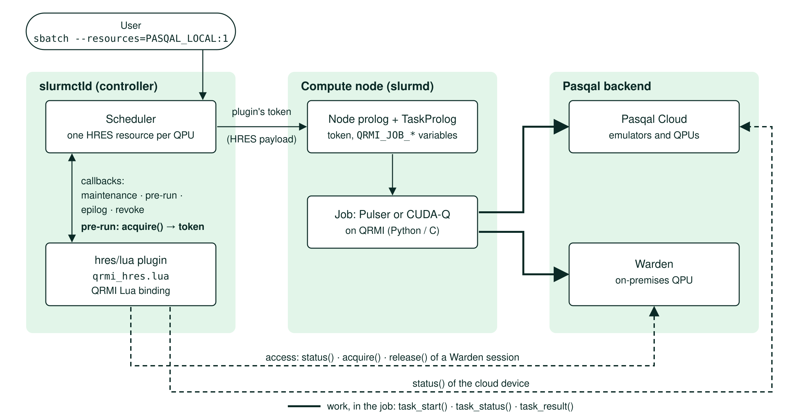
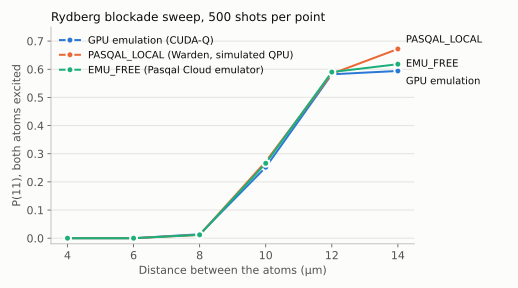

# A Pasqal QPU as a Slurm HRES resource

Companion example of the Pasqal blog post
[*Enabling hybrid GPU–QPU workflows with Slurm HRES and Pasqal QPUs*](https://www.pasqal.com/blog/enabling-hybrid-gpu-qpu-workflows-with-slurm-hres-and-pasqal-qpus/),
published with the Slurm expansion
[announced by NVIDIA](https://blogs.nvidia.com/blog/slurm-quantum-computing-supercomputing), joint work of
Pasqal, NVIDIA and IBM. It contains the configuration, the programs and the tests used in the post, and
the full results of its GPU-to-QPU workflow. That workflow also shows new work by Pasqal with NVIDIA:
Pasqal's CUDA-Q integration now includes GPU emulation (CUDA-Q 0.17), so the same program runs on a GPU
and then on the QPU.

A small neutral-atom program runs as an ordinary Slurm batch job. The QPU is a Slurm
[hierarchical resource (HRES)](https://slurm.schedmd.com/hres.html) that the job requests with
`--resources=<QPU>:1` (`--licenses` requests the same). The Slurm controller checks the QPU's status
and manages access to it through [QRMI](https://github.com/qiskit-community/qrmi) (for Pasqal Local, a
Warden session per job), using the `hres/lua` plugin and `qrmi_hres.lua` from the HRES–QRMI
integration, [slurm-hres-plugins](https://github.com/qrmi-community/slurm-hres-plugins), developed by IBM
and Pasqal. The job submits its work to whichever Pasqal backend it was given.



## At a glance

| Resource | Backend | QRMI resource type |
|---|---|---|
| `EMU_FREE` | Emulator on Pasqal Cloud | `pasqal-cloud` |
| `FRESNEL_CAN1` | QPU on Pasqal Cloud; the user's Pasqal Cloud project needs QPU access | `pasqal-cloud` |
| `PASQAL_LOCAL` | On-premises QPU behind [Warden](https://github.com/pasqal-io/warden); the test cluster uses Warden with a simulated QPU | `pasqal-local` |

```bash
sbatch --resources=EMU_FREE:1 blockade.sbatch                      # Pulser, EMU_FREE emulator on Pasqal Cloud
sbatch --resources=FRESNEL_CAN1:1 blockade.sbatch                  # Pulser on the FRESNEL_CAN1 QPU
sbatch --resources=PASQAL_LOCAL:1 blockade.sbatch                  # Pulser on the on-premises QPU
sbatch --resources=EMU_FREE:1 blockade.sbatch blockade_cudaq.py    # CUDA-Q (needs CUDA-Q 0.17, see below)
GPU_REQUEST=--gres=gpu:1 EMU_ARGS="--rydberg-c6 5420158.53e-30" \
  ./gpu_to_qpu.sh PASQAL_LOCAL                                     # from GPU emulation to the QPU, see below
```

## Results

### From GPU to QPU

The CUDA-Q blockade program ran at six atom distances, first emulated on a GPU and then, unchanged, on
each backend. As the atoms move apart, the Rydberg blockade weakens and both atoms are excited together
more often.



| Distance (µm) | P(11), GPU emulation | P(11), PASQAL_LOCAL | P(11), EMU_FREE |
|---|---|---|---|
| 4 | 0.000 | 0.000 | 0.000 |
| 6 | 0.000 | 0.000 | 0.000 |
| 8 | 0.014 | 0.012 | 0.012 |
| 10 | 0.252 | 0.272 | 0.266 |
| 12 | 0.582 | 0.584 | 0.590 |
| 14 | 0.594 | 0.672 | 0.618 |

| Job | Time for the six points |
|---|---|
| GPU emulation (`--gres=gpu:1`, RTX 3080) | 16 s |
| `PASQAL_LOCAL` (simulated QPU) | 44 s |
| `EMU_FREE` | 2 min 33 s |

500 shots per point, CUDA-Q built from main d3e471dc, emulation with the level-70 C6 (see below). The
largest differences from the emulation were 0.092 (`PASQAL_LOCAL`) and 0.016 (`EMU_FREE`); with 500
shots the difference of two measurements has a standard deviation of up to 0.032, and each run compares
12 values. With FRESNEL's C6, the emulation agrees with a QuTiP simulation of the same pulse in Pulser
to within 0.011 (20,000 shots, 4–14 µm; 4σ = 0.014). A re-run on 2026-11-14 with the versions in [The
container test cluster](#the-container-test-cluster) (Slurm 26.11.0rc1, QRMI 0.27.0) differed from the
emulation by at most 0.060 (`PASQAL_LOCAL`) and 0.032 (`EMU_FREE`). How to run it: [Run the GPU-to-QPU
workflow](#run-the-gpu-to-qpu-workflow).

### Blockade and job lifecycle

The Pulser and CUDA-Q versions of the blockade program passed on `EMU_FREE` and `PASQAL_LOCAL`, all four
combinations, and the Pulser version ran unchanged on the `FRESNEL_CAN1` QPU (one shot, see
[Limits](#limits)). `tests/e2e.sh` also checks the job lifecycle a shared QPU needs; see
[The container test cluster](#the-container-test-cluster). Expected output, from a run on `EMU_FREE`:

```
QPU resources: EMU_FREE (pasqal-cloud)
Atoms 5 um apart; blockade radius on FRESNEL_CAN1: 8.1 um
500 shots: P(00)=0.002, P(01)=0.496, P(10)=0.502, P(11)=0.000
blockade OK
```

## The program

Two atoms 5 µm apart get a global pulse that is a π pulse for the pair under the Rydberg blockade:
only one of them can be excited, so the measured bitstrings are `01` and `10`, about half each, and
almost never `11`. `check_counts.py` checks this: P(11) ≤ 0.05, P(01)+P(10) ≥ 0.75 and
|P(01)−P(10)| ≤ 4/√N. Outside the blockade, e.g. `--distance 15`, the check fails.

| File | |
|---|---|
| `blockade.py` | [Pulser](https://github.com/pasqal-io/Pulser) version. Builds the sequence for the device the QRMI resource reports, on calibrated traps of its pre-calibrated layouts when it has them, so it runs unchanged on a QPU such as `FRESNEL_CAN1` (at trap distances of its 5 µm triangular lattice: 5, 8.66, 10, 13.2, 15 µm, …). `--simulate` runs it on the CPU with QuTiP instead |
| `blockade_cudaq.py` | [CUDA-Q](https://github.com/NVIDIA/cuda-quantum) version, `cudaq.set_target("pasqal", machine="qrmi")`. `--emulate` runs it on a local GPU instead |
| `blockade.sbatch` | Batch script: runs a program on the job's QPU, then `check_counts.py` |
| `sweep.sbatch`, `compare_sweep.py`, `gpu_to_qpu.sh` | From GPU to QPU: the CUDA-Q program over several atom distances, emulated on a GPU and then run on the QPU, and compared |
| `cluster/` | Slurm and QRMI configuration, the test cluster's compose overrides and images (job Python environment, Warden with a simulated QPU, CUDA-Q) |
| `tests/e2e.sh` | End-to-end test on the container cluster |

## Run it on a cluster

The cluster needs Slurm 26.11 with the `hres/lua` plugin (tested with 26.11.0rc1), `qrmi_hres.lua`, the
QRMI Lua module and the TaskProlog from slurm-hres-plugins, and QRMI 0.26.4 or newer (tested with 0.27.0).

1. Copy `cluster/resources.yaml` and `cluster/qrmi_config.json` to the directory of `slurm.conf` on the
   controller, adjust the node list and `QRMI_WARDEN_URL`, and run `scontrol reconfigure`.
   `scontrol show licenses` then lists `EMU_FREE`, `FRESNEL_CAN1` and `PASQAL_LOCAL`.
2. Pasqal Cloud: each user puts their [Pasqal Cloud](https://portal.pasqal.cloud) credentials in
   `~/.pasqal/config` on the compute nodes:

   ```
   username=<user name>
   password=<password>
   project_id=<project id>
   ```

   `FRESNEL_CAN1` needs a project with QPU access.

   Pasqal Local needs no user credentials: Warden identifies the job's user with MUNGE. `qrmi_hres.lua`
   opens and ends the Warden sessions as SlurmUser, so Warden's `api.admin_users` must list its UID.
3. The batch scripts activate the job Python environment `/opt/qrmi/venv` (QRMI and Pulser, see
   `cluster/Dockerfile`); change that line for your cluster. Submit the jobs from
   [At a glance](#at-a-glance) in a copy of this repository on a file system the compute nodes share.
   The output is in `blockade_<job id>.out`.

## The container test cluster

It is the cluster from slurm-hres-plugins `containers/`, run as compose project `hres`.
`cluster/compose.example.yml` adds the job Python environment (`cluster/Dockerfile`: QRMI, Pulser) on
the login and compute nodes, Warden with a simulated QPU (`cluster/warden/`) and this repository at
`/opt/example`:

```bash
git clone https://github.com/qrmi-community/slurm-hres-plugins
cd slurm-hres-plugins/containers
git checkout d538b6c   # the tested commit
docker build --build-arg SLURM_TAG=slurm-26-11-0-0rc1 --build-arg QRMI_REF=0.27.0 \
  -t slurm-docker-cluster:26.11.0.0rc1 .   # the IMAGE_TAG in .env
# Absolute paths; the Pasqal Cloud config file must exist (see "Run it on a cluster", step 2)
export EXAMPLE_DIR=<this repository> PASQAL_CONFIG=$HOME/.pasqal/config
C="docker compose -p hres -f compose.yml -f $EXAMPLE_DIR/cluster/compose.example.yml"
$C build c1 warden && $C up -d
docker cp $EXAMPLE_DIR/cluster/resources.yaml hres-slurmctld:/etc/slurm/
docker cp $EXAMPLE_DIR/cluster/qrmi_config.json hres-slurmctld:/etc/slurm/
docker exec hres-slurmctld scontrol reconfigure

$EXAMPLE_DIR/tests/e2e.sh PASQAL_LOCAL
$EXAMPLE_DIR/tests/e2e.sh EMU_FREE
```

`tests/e2e.sh <QPU>` checks, for one resource:

1. The example job completes and passes `check_counts.py`, and the controller releases its token.
2. With `count: 1`, a second job starts only after the first one ended.
3. A running job holds a token on the controller, and `scancel` releases it.
4. `PASQAL_LOCAL` only: Warden's records show one ended session per Slurm job; with Warden stopped, the
   resource is disabled, a new job waits with the reason `HRESDisabled`, and it runs once Warden is back.

### CUDA-Q

`cluster/Dockerfile.cudaq` adds CUDA-Q to the image and `cluster/compose.cudaq.yml` uses it;
`cluster/compose.gpu.yml` also gives the compute nodes the GPU (NVIDIA Container Toolkit), for
`--emulate`. Recreated nodes get new addresses, so reconfigure Slurm afterwards:

```bash
docker build -f $EXAMPLE_DIR/cluster/Dockerfile.cudaq -t localhost/slurm-pasqal-cudaq:hres $EXAMPLE_DIR/cluster
$C -f $EXAMPLE_DIR/cluster/compose.cudaq.yml up -d c1 c2 slurm-login   # add -f .../compose.gpu.yml for a GPU
docker exec hres-slurmctld scontrol reconfigure
$EXAMPLE_DIR/tests/e2e.sh EMU_FREE blockade_cudaq.py
```

Under HRES, CUDA-Q needs version 0.17 or newer (NVIDIA/cuda-quantum#4296: CUDA-Q 0.16 reads only the
older `SLURM_JOB_QPU_*` names, which the HRES TaskProlog does not set; #5494 adds `--emulate`). On
`PASQAL_LOCAL`, it also needs a Warden release with pasqal-io/warden#116, which rounds CUDA-Q pulse
durations to the QPU's 4 ns clock; `cluster/warden/` builds Warden with it.

## Run the GPU-to-QPU workflow

`gpu_to_qpu.sh <QPU>` submits three dependent jobs: `sweep.sbatch --emulate` runs `blockade_cudaq.py` at
4–14 µm on a GPU; only if that job succeeds does the same sweep run on the QPU (`--resources=<QPU>:1`,
`--dependency=afterok`); `compare_sweep.py` then checks that P(11) and P(01)+P(10) agree within 0.1 at
every distance. The GPU job holds no QPU and the QPU job no GPU; if the emulation fails, Slurm cancels
the QPU job (`--kill-on-invalid-dep`) and the QPU is never used. `GPU_REQUEST` adds the GPU request of
your cluster, e.g. `GPU_REQUEST=--gres=gpu:1`. On the test cluster that needs `GresTypes=gpu` and
`Gres=gpu:1` on the `NodeName` line in `slurm.conf`, `NodeName=c[1-2] Name=gpu File=/dev/nvidia0` in
`gres.conf`, and `scontrol reconfigure`.

Emulate with the interaction strength of the device that runs the program. CUDA-Q's emulation
defaults to FRESNEL's C6/ħ = 8.66e-25 rad m⁶/s (Rydberg level 60). Warden uses its QPU's device, here
the simulated QPU's `DigitalAnalogDevice` (level 70, 5.42e-24), and `EMU_FREE` behaved like level 70
too although it reports FRESNEL_CAN1. Level 70 moves the blockade radius of this pulse from about 8 µm
to 11 µm, so both sweeps run with:

```bash
GPU_REQUEST=--gres=gpu:1 EMU_ARGS="--rydberg-c6 5420158.53e-30" ./gpu_to_qpu.sh PASQAL_LOCAL
```

## Limits

- The tests in `tests/` use no physical QPU: `EMU_FREE` is an emulator, and the Warden test setup
  simulates the QPU with QuTiP. `blockade.py` runs unchanged on the `FRESNEL_CAN1` QPU, with a Pasqal
  Cloud project that has QPU access: one shot on 2026-11-14 measured `01` and passed `check_counts.py`.
  `EMU_FREE` reports FRESNEL_CAN1's specifications and runs the same sequence. The CUDA-Q version sends
  atom positions, which Pasqal Cloud places on the device.
- `hres/lua` is new in Slurm 26.11 (tested with the release candidate 26.11.0rc1), and HRES is a beta
  feature of Slurm.
- `count` in `resources.yaml` is the only limit on concurrent jobs per QPU: QRMI's Pasqal Local status
  reports online/offline, not free capacity.
- The controller releases a token at its next maintenance run, up to `maintenance_cycle` seconds after
  the job ends.
- A single failed status call (e.g. a short Pasqal Cloud API outage) disables the resource until the
  next maintenance run; jobs submitted then wait.
- The job's user can read the acquisition token, as with the
  [QRMI SPANK plugin](https://github.com/qiskit-community/spank-plugins).

## License

The scripts and Python files outside `cluster/` are Copyright (c) 2026 Pasqal, under the Pasqal
Open-Source Software License (MIT-derived), see [LICENSE](LICENSE). The files in `cluster/` are adapted
from the [SC26 QRMI tutorial](https://github.com/qrmi-community/SC26) (`cluster/warden/`) and
[slurm-hres-plugins](https://github.com/qrmi-community/slurm-hres-plugins) (the Slurm and QRMI
configuration and the container files) and keep their licence, the
[Apache License 2.0](https://www.apache.org/licenses/LICENSE-2.0). All other material (documentation and
figures) is Copyright (c) 2026 Pasqal. All rights reserved.
